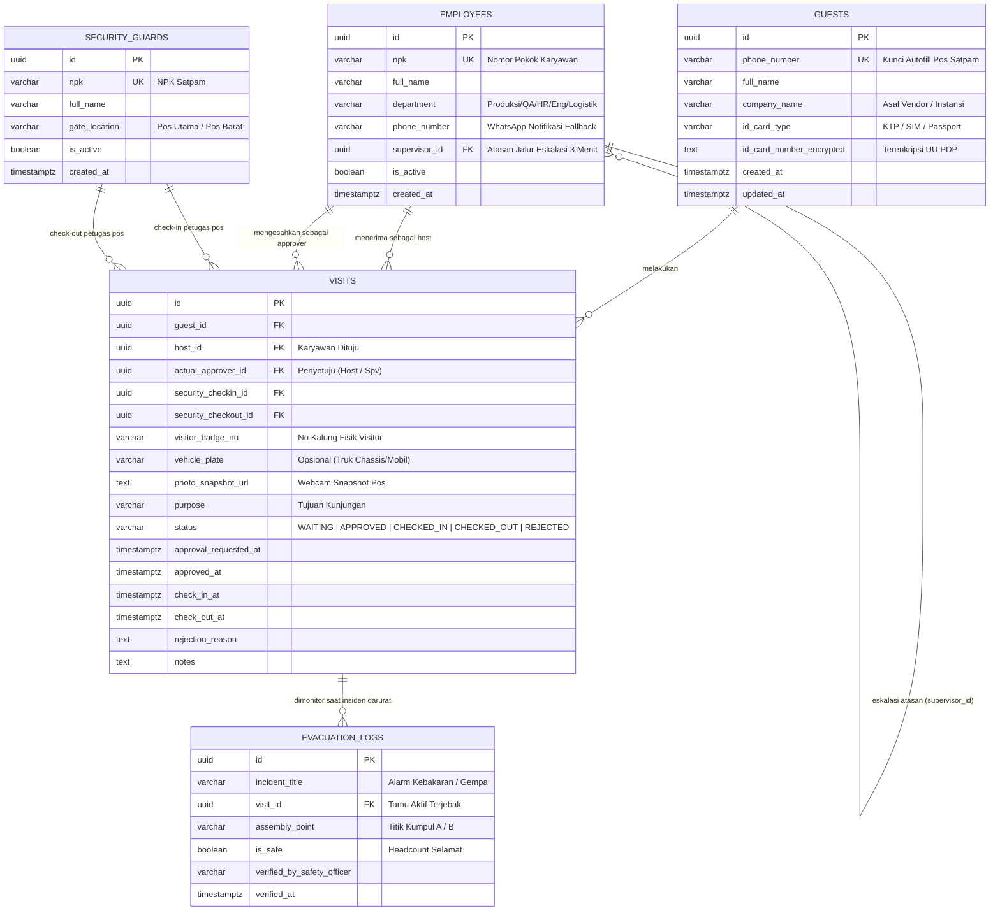

# Database Specification & DDL Schema: P1 — Buku Tamu Digital & Approval Host K3

> **Dokumen Teknis Rekayasa Data**  
> **Sistem:** Visitor Access Control & HSE Emergency Evacuation Management  
> **Target Database Engine:** PostgreSQL 15+ / Supabase / PocketBase  
> **Status:** Production-Ready Schema Draft  

---

## 1. Konsep & Filosofi Skema Data

Sesuai prinsip **AGENTS.md** (efisiensi solo developer, performa tinggi di pos satpam, dan kepatuhan K3):
1. **Target Waktu Input Pos Satpam:** $\le 30$ detik per orang melalui pemisahan master tamu (`guests`) dan riwayat sesi kunjungan (`visits`) dengan indeks unik pada nomor HP untuk *instant autofill*.
2. **Kepatuhan K3 & Evakuasi Darurat:** Indeks parsial khusus untuk kueri live headcount tamu di lini produksi (`status = 'CHECKED_IN' AND check_out_at IS NULL`) dengan response time $< 2$ milidetik.
3. **Kepatuhan Privasi (UU No. 27/2022 PDP):** Nomor identitas KTP/SIM dienkripsi pada layer data dan disiapkan kebijakan masking setelah 6 bulan retensi.

---

## 2. Diagram Relasi Entitas (ERD)



---

## 3. Data Definition Language (DDL SQL)

Skrip SQL PostgreSQL yang dapat langsung dieksekusi:

```sql
-- ============================================================================
-- EXTENSION & ENUM TYPES
-- ============================================================================
CREATE EXTENSION IF NOT EXISTS "uuid-ossp";
CREATE EXTENSION IF NOT EXISTS "pgcrypto";

-- Enum Tipe Identitas Tamu
CREATE TYPE guest_id_type AS ENUM ('KTP', 'SIM', 'PASSPORT');

-- Enum Status Siklus Kunjungan
CREATE TYPE visit_status AS ENUM (
    'WAITING_APPROVAL', 
    'APPROVED', 
    'REJECTED', 
    'CHECKED_IN', 
    'CHECKED_OUT', 
    'CANCELLED'
);

-- ============================================================================
-- 1. TABEL: guests (Master Tamu & Autofill Profile)
-- ============================================================================
CREATE TABLE guests (
    id UUID PRIMARY KEY DEFAULT gen_random_uuid(),
    phone_number VARCHAR(20) NOT NULL,
    full_name VARCHAR(150) NOT NULL,
    company_name VARCHAR(150) NOT NULL,
    id_card_type guest_id_type NOT NULL DEFAULT 'KTP',
    id_card_number_encrypted TEXT NOT NULL,
    created_at TIMESTAMPTZ NOT NULL DEFAULT NOW(),
    updated_at TIMESTAMPTZ NOT NULL DEFAULT NOW()
);

-- Indeks unik nomor HP untuk autofill pos satpam dalam waktu < 5 milidetik
CREATE UNIQUE INDEX idx_guests_phone ON guests(phone_number);
CREATE INDEX idx_guests_company ON guests(company_name);

-- ============================================================================
-- 2. TABEL: employees (Master Host & Atasan Eskalasi)
-- ============================================================================
CREATE TABLE employees (
    id UUID PRIMARY KEY DEFAULT gen_random_uuid(),
    npk VARCHAR(30) NOT NULL UNIQUE,
    full_name VARCHAR(150) NOT NULL,
    department VARCHAR(100) NOT NULL,
    phone_number VARCHAR(20) NOT NULL,
    supervisor_id UUID REFERENCES employees(id) ON DELETE SET NULL,
    is_active BOOLEAN NOT NULL DEFAULT TRUE,
    created_at TIMESTAMPTZ NOT NULL DEFAULT NOW(),
    updated_at TIMESTAMPTZ NOT NULL DEFAULT NOW()
);

CREATE INDEX idx_employees_department ON employees(department);
CREATE INDEX idx_employees_supervisor ON employees(supervisor_id);

-- ============================================================================
-- 3. TABEL: security_guards (Akuntabilitas Petugas Pos)
-- ============================================================================
CREATE TABLE security_guards (
    id UUID PRIMARY KEY DEFAULT gen_random_uuid(),
    npk VARCHAR(30) NOT NULL UNIQUE,
    full_name VARCHAR(150) NOT NULL,
    gate_location VARCHAR(50) NOT NULL DEFAULT 'Pos Gerbang Utama',
    is_active BOOLEAN NOT NULL DEFAULT TRUE,
    created_at TIMESTAMPTZ NOT NULL DEFAULT NOW()
);

-- ============================================================================
-- 4. TABEL: visits (Transaksi Kunjungan & Sesi Akses Pabrik)
-- ============================================================================
CREATE TABLE visits (
    id UUID PRIMARY KEY DEFAULT gen_random_uuid(),
    guest_id UUID NOT NULL REFERENCES guests(id) ON DELETE RESTRICT,
    host_id UUID NOT NULL REFERENCES employees(id) ON DELETE RESTRICT,
    actual_approver_id UUID REFERENCES employees(id) ON DELETE SET NULL,
    security_checkin_id UUID NOT NULL REFERENCES security_guards(id) ON DELETE RESTRICT,
    security_checkout_id UUID REFERENCES security_guards(id) ON DELETE SET NULL,
    visitor_badge_no VARCHAR(30),
    vehicle_plate VARCHAR(20),
    photo_snapshot_url TEXT NOT NULL,
    purpose VARCHAR(50) NOT NULL,
    status visit_status NOT NULL DEFAULT 'WAITING_APPROVAL',
    approval_requested_at TIMESTAMPTZ NOT NULL DEFAULT NOW(),
    approved_at TIMESTAMPTZ,
    check_in_at TIMESTAMPTZ,
    check_out_at TIMESTAMPTZ,
    rejection_reason TEXT,
    notes TEXT,
    created_at TIMESTAMPTZ NOT NULL DEFAULT NOW(),
    updated_at TIMESTAMPTZ NOT NULL DEFAULT NOW()
);

-- Indeks Kunci untuk Dashboard K3 Darurat (Realtime Headcount Occupancy)
CREATE INDEX idx_visits_k3_occupancy 
ON visits (check_in_at) 
WHERE status = 'CHECKED_IN' AND check_out_at IS NULL;

-- Indeks Transaksi Harian Pos Satpam
CREATE INDEX idx_visits_status ON visits(status);
CREATE INDEX idx_visits_host ON visits(host_id);
CREATE INDEX idx_visits_check_in_at ON visits(check_in_at DESC);

-- ============================================================================
-- 5. TABEL: evacuation_logs (Insiden & Kepatuhan Audit K3)
-- ============================================================================
CREATE TABLE evacuation_logs (
    id UUID PRIMARY KEY DEFAULT gen_random_uuid(),
    incident_title VARCHAR(150) NOT NULL,
    visit_id UUID NOT NULL REFERENCES visits(id) ON DELETE CASCADE,
    assembly_point VARCHAR(50) NOT NULL DEFAULT 'Titik Kumpul Utama',
    is_safe BOOLEAN NOT NULL DEFAULT FALSE,
    verified_by_safety_officer VARCHAR(100),
    verified_at TIMESTAMPTZ,
    created_at TIMESTAMPTZ NOT NULL DEFAULT NOW()
);

CREATE INDEX idx_evacuation_visit ON evacuation_logs(visit_id);
CREATE INDEX idx_evacuation_safe ON evacuation_logs(is_safe);
```

---

## 4. Query Kunci untuk Kebutuhan Operasional Pabrik

### 4.1 Autofill Tamu Pos Satpam (Waktu Eksekusi: < 3ms)
```sql
SELECT id, full_name, company_name, id_card_type
FROM guests
WHERE phone_number = :input_phone_number
LIMIT 1;
```

### 4.2 K3 Live Emergency Roll Call (Headcount Tamu Terjebak di Pabrik)
```sql
SELECT 
    v.id AS visit_id,
    g.full_name AS guest_name,
    g.company_name,
    g.phone_number AS guest_phone,
    v.visitor_badge_no,
    v.vehicle_plate,
    v.photo_snapshot_url,
    e.full_name AS host_name,
    e.department AS visited_department,
    v.check_in_at
FROM visits v
JOIN guests g ON v.guest_id = g.id
JOIN employees e ON v.host_id = e.id
WHERE v.status = 'CHECKED_IN' AND v.check_out_at IS NULL
ORDER BY v.check_in_at ASC;
```

### 4.3 Trigger Auto-Eskalasi 3 Menit (Host Tidak Membuka Notifikasi)
```sql
SELECT 
    v.id AS visit_id,
    g.full_name AS guest_name,
    e.full_name AS host_name,
    s.full_name AS supervisor_name,
    s.phone_number AS supervisor_wa
FROM visits v
JOIN guests g ON v.guest_id = g.id
JOIN employees e ON v.host_id = e.id
JOIN employees s ON e.supervisor_id = s.id
WHERE v.status = 'WAITING_APPROVAL' 
  AND v.approval_requested_at < NOW() - INTERVAL '3 minutes';
```

---

## 5. Keamanan & Kebijakan Masking (UU PDP No. 27/2022)

Untuk menjamin kepatuhan audit hukum privasi, dibuat prosedur penyimpanan data terenkripsi dan pembersihan berkala:
* Kolom `id_card_number_encrypted` disimpan menggunakan enkripsi simetris `pgp_sym_encrypt(raw_id, 'KUNCI_RAHASIA_ENV')`.
* Log kunjungan di atas 6 bulan otomatis di-anonymize menggunakan scheduled cron job:
  ```sql
  UPDATE guests 
  SET id_card_number_encrypted = 'MASKED_EXPIRED'
  WHERE id IN (
      SELECT guest_id FROM visits 
      GROUP BY guest_id 
      HAVING MAX(check_in_at) < NOW() - INTERVAL '180 days'
  );
  ```
